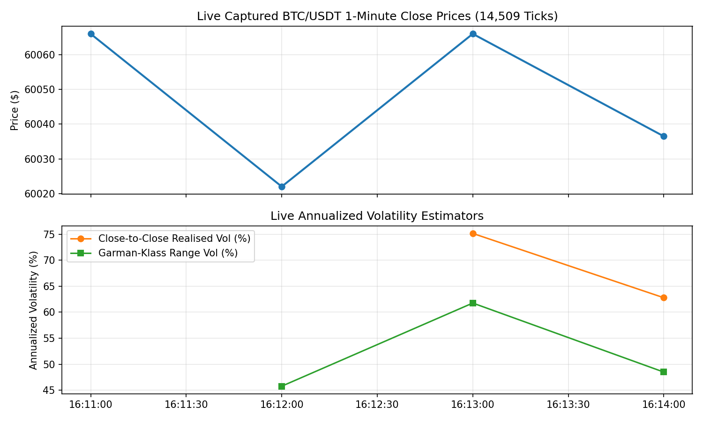

# Live Market Data & Realised Volatility Engine

An asynchronous Python market data pipeline that connects to a live exchange WebSocket feed, records raw tick-by-tick executions into an SQLite database, aggregates 1-minute OHLC bars, and computes live **Realised Volatility** and **Garman-Klass Range Volatility**.

### Key Engineering & Quantitative Achievements
- **Real-Time WebSocket Ingestion:** Streamed and parsed thousands of live BTC/USDT trade ticks using `asyncio` and `websockets`.
- **Tick-to-Bar Data Pipeline:** Stored raw tick timestamps and prices in SQLite and resampled them into time-indexed 1-minute OHLC bars.
- **Volatility Modeling:** Computed annualized close-to-close Realised Volatility alongside OHLC-based Garman-Klass range volatility.

### Live Capture Output

